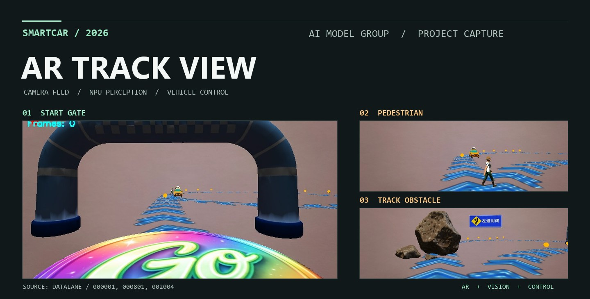
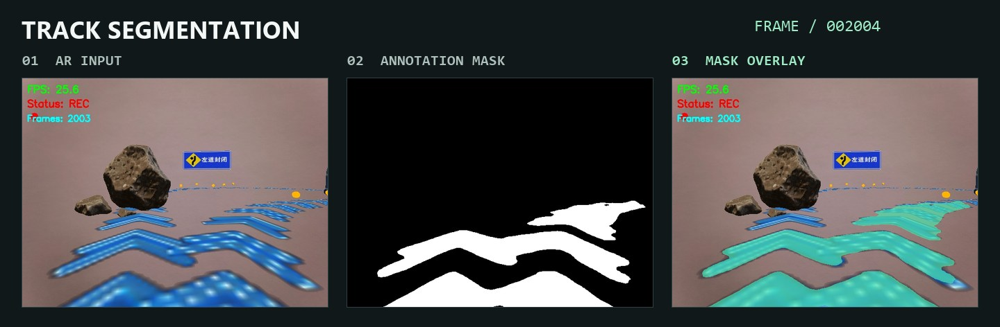
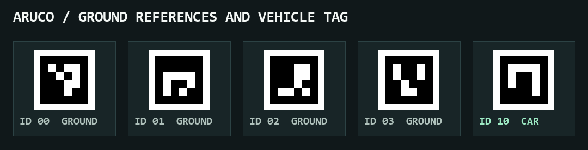
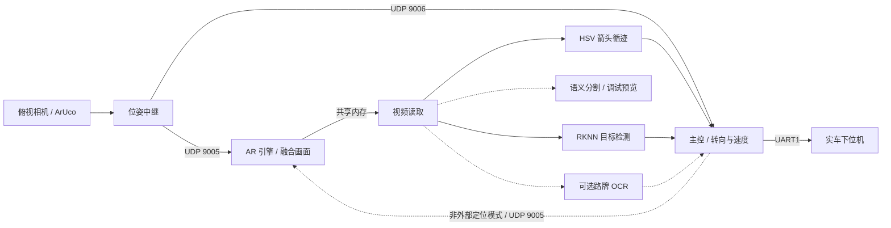

<div align="center">

# SmartCar 2026 · AR 视觉智能车

**从蓝色赛道箭头，到一辆模型车的转向。**

第二十一届全国大学生智能汽车竞赛 · 人工智能模型组

Python · OpenCV · RKNN / Rockchip NPU · ArUco · UART / UDP

[功能展示](#功能展示) · [快速开始](#快速开始) · [技术架构](#技术架构) · [仓库结构](#仓库结构) · [演示视频](https://github.com/yuhuang007/smartCar_2026/releases/tag/archive-2026)



</div>

## 项目概览

SmartCar 2026 是一套面向**封闭竞赛赛道**的模型车视觉与控制工程。程序读取 AR 融合画面，用蓝色箭头估计赛道走向，结合目标检测和可选的定位数据计算转向与速度，再通过串口驱动模型车。仓库同时保留了语义分割实验、虚拟车接口和采集标注数据。

| 4,755 对标注样本 | 4 + 1 个定位标记 | 2 类控制接口 |
| :---: | :---: | :---: |
| 原帧与赛道掩膜按文件名配对 | 4 个地面参考点，1 个车体标记 | UART 实车控制，UDP 虚拟车 / 位姿通信 |

## 功能展示

### 循着蓝色箭头过弯

主控使用 HSV 提取蓝色箭头，通过近、远视野估计横向偏差和前方走向。目标检测提供行人、小车等目标信息；交通灯和路牌 OCR 分支保留在源码中，OCR 在主版本默认关闭。

下图展示另一条感知路径使用的**数据集标注**：左为原始 AR 帧，中间为赛道掩膜，右为叠加预览。这不是模型推理截图。



### 用俯视摄像头给模型车定位

固定摄像头识别四角标记，建立图像像素到赛场平面的映射；识别车体标记后得到位置和航向。`location_bridge.py` 可把位姿转发给 AR 引擎与主控。也可以先单独运行定位工具，不连接模型车。



## 快速开始

### 在电脑上离线跑一帧

这条路径只读取仓库中的图片，**不需要板卡、摄像头、网络服务或车辆**。克隆私有仓库时需要账号具有读取权限。

```bash
git clone https://github.com/yuhuang007/smartCar_2026.git
cd smartCar_2026
python -m pip install -r aruco/requirements.txt
python -c "import sys, cv2; sys.path.insert(0, 'setupUI(YS)'); from stream_seg_test import ArrowNavigator; frame = cv2.imread('datalane/Images/frame_002004.jpg'); offset, _, valid, _ = ArrowNavigator().navigate(frame); print(f'valid={valid}, offset={offset:+.3f}')"
```

输出 `valid` 表示该帧是否检测到有效箭头；`offset` 为转向偏移，正值向右、负值向左。

<details>
<summary>展开：独立运行 ArUco 定位</summary>

在仓库根目录安装上述依赖，再进入 `aruco/`：

```bash
cd aruco
python generate_markers.py
python map_calibrate.py
python track.py
```

按实际场地设置 [`config.py`](aruco/config.py) 中的相机与坐标参数。改变相机、安装高度或标记布局后重新标定，不要套用仓库里的历史 `homography.npz`。打印请使用 [`*_pure.png`](aruco/markers/) 源文件。详见 [ArUco 使用说明](aruco/README.md)。

</details>

### 在 RK3588 板卡联调

1. 准备兼容的 RKNN Lite 运行时、板卡驱动和 AR 引擎，以及 Python 依赖 OpenCV、NumPy、pyserial、requests。第三方 AR 引擎和设备授权不随仓库提供。
2. 在 [`main_control.py`](setupUI%28YS%29/main_control.py) 的 `CONFIG` 中核对共享内存、串口和定位模式。只联调视觉时，断开电机供电，并将 `debug_mode` 设为 `True`、`uart1_enable` 和 `enable_virtual_car` 设为 `False`；确认软件退出和停车状态后再接入封闭赛道上的模型车。
3. 启动 AR 引擎、确认共享内存能输出画面后，从对应工程目录启动主控：

   ```bash
   cd 'setupUI(YS)'
   python3 main_control.py
   ```

若使用 ArUco 中继，先在定位电脑完成标定，然后将 [`location_bridge.py`](setupUI%28YS%29/location_bridge.py) 的目标地址改为实际板卡地址。OCR 是可选模块；需要时只在本机副本中配置自己的凭据。早期交接笔记里的 IP、舵机方向和速度参数不应直接照搬。

## 技术架构



| 模块 | 入口 | 职责 |
| --- | --- | --- |
| 采集与控制 | [`main_control.py`](setupUI%28YS%29/main_control.py) | 读取共享内存、融合感知结果、输出控制 |
| 循迹与分割 | [`stream_seg_test.py`](setupUI%28YS%29/stream_seg_test.py) · [`seg_infer/`](setupUI%28YS%29/seg_infer/) | HSV 箭头提取、近远视野偏差、RKNN 分割封装 |
| 目标检测与 OCR | [`infer_wrap/`](setupUI%28YS%29/infer_wrap/) · [`ocr_sign/`](setupUI%28YS%29/ocr_sign/) | NPU 检测及可选路牌识别 |
| 定位和执行接口 | [`aruco/`](aruco/) · [`serial_comm/`](setupUI%28YS%29/serial_comm/) · [`virtual_car/`](setupUI%28YS%29/virtual_car/) | 相机标定、车体定位、串口与虚拟车通信 |

## 仓库结构

```text
smartCar_2026/
├── setupUI(YS)/          主控、感知模块、板卡模型与交接记录
├── setupUI/              AR 视频接收、分割实验与界面模板
├── setupUI(YS).../       5 份历史源码快照（含一份从 ZIP 恢复的版本）
├── aruco/                相机标定、标记生成和位置跟踪
├── datalane/
│   ├── Images/           已标注的 4,755 张 JPG 原帧
│   ├── Annotations/      一一配对的 4,755 张 PNG 掩膜
│   └── Unlabeled/        另外 3 张未标注帧
├── docs/
│   ├── materials/        规则手册、板卡手册与入门资料
│   └── readme/           首页配图及来源说明
├── model.rknn           根目录检测模型
└── label_list.txt       原目录随附的标签记录
```

| 找什么 | 去哪里 |
| --- | --- |
| 调参过程、已知问题 | [项目转接记录 V2](setupUI%28YS%29/项目转接文档_v2.md) |
| 实车串口联调 | [UART1 指令记录](setupUI%28YS%29/UART1_串口指令文档%283%29.md) |
| 数据、配图和归档范围 | [归档说明](docs/ARCHIVE.md) · [配图来源](docs/readme/README.md) |
| 赛道视频 | [项目归档 Release](https://github.com/yuhuang007/smartCar_2026/releases/tag/archive-2026) |

历史版本和交接记录供对照，不代表当前主控配置。第三方引擎、SDK、权重及资料的再分发应遵循各自的授权条款；本仓库未附统一开源许可证。
